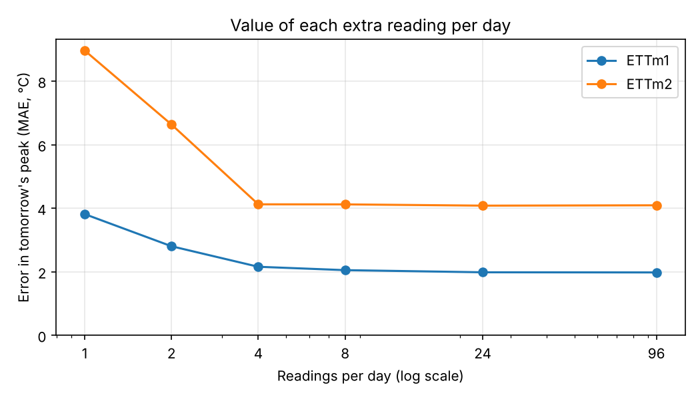

# How often should a transformer be checked?

**Daily check-sheet readings vs continuous monitoring for forecasting transformer oil-temperature peaks**

Many transformers and backup power assets are still monitored with a manual daily check sheet. This small study asks how much worse one daily reading is than continuous monitoring at anticipating *tomorrow's peak oil temperature*, and how many readings per day are enough to close the gap.

## Key findings

| Transformer | Error with one 9 a.m. reading | Error with continuous monitoring |
| --- | --- | --- |
| ETTm1 | 3.8 °C | 2.0 °C |
| ETTm2 | 9.0 °C | 4.1 °C |

- One daily reading roughly doubles the error compared with continuous monitoring.
- About 4 evenly spaced readings per day (one every 6 hours) close almost all of the gap; more readings add very little.
- The size of the gap differs between transformers, so the right monitoring frequency depends on the asset.

Error = mean absolute error over 725 days. The guesses are deliberately simple (today's highest available reading as the guess for tomorrow's peak), so the study measures how much information the readings carry, not the best possible forecast.

## Data

Electricity Transformer Dataset (ETDataset): two transformers, July 2016 – June 2018, one row every 15 minutes, with oil temperature (`OT`) and six load features.

- Source: <https://github.com/zhouhaoyi/ETDataset>
- Paper: Zhou et al., *Informer: Beyond Efficient Transformer for Long Sequence Time-Series Forecasting*, AAAI 2021.
- Licence: CC BY-ND 4.0. The notebook loads the data from the original link; no copy of the data is stored in this repository.

## How to run

Open `transformer_checksheet_vs_monitoring.ipynb` in Google Colab or Jupyter and run all cells. Requires `pandas` and `matplotlib`.

## Limits

- Two transformers, two years, one region; no ambient temperature and no failure records.
- Real check sheets also have late or missed readings, which are not simulated here.

## Next steps

- Test whether a simple model with load data makes sparse readings more useful.
- Simulate missed or late manual readings.
- Link monitoring frequency to cost: when is an extra sensor worth it?

## Author

Syed Ali Abbas – electrical engineer (power), 4 years of operation and maintenance of generators, transformers and UPS systems at Multan International Airport and on the M5 motorway, Pakistan.
